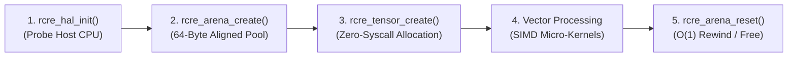

# RCRE Project Starter Template — Developer Mini Guideline

> **Compact Cheat Sheet & Best Practices for Building High-Performance C23 Applications.**
> 
> 📖 *For a gentle 10-page visual explanation for non-CS practitioners, see the [Beginner's Mini E-Book](MINI_EBOOK.md).*

---

## 1. 60-Second Quick Start Cheat Sheet

```bash
# 1. Enter the project template directory
cd apps/rcre/project-template

# 2. Build and run optimized release binary (logs output to logs/sample_run.log)
make run

# 3. Run verification test suite under AddressSanitizer (ASan) & UndefinedBehaviorSanitizer (UBSan)
make test

# 4. Clean compiled binaries and intermediate build artifacts
make clean
```

---

## 2. Directory Layout at a Glance

| Path | Purpose |
| :--- | :--- |
| [`include/rcre.h`](include/rcre.h) | Self-contained amalgamated single-header engine (~14k lines, zero external dependencies). |
| [`src/main.c`](src/main.c) | Starter application entry point showcasing HAL detection, arenas, tensors, and SIMD filters. |
| [`tests/test_main.c`](tests/test_main.c) | Zero-dependency unit tests running under `-fsanitize=address,undefined`. |
| [`Makefile`](Makefile) | Turnkey build file supporting `-O3`, ASan, UBSan, and real-time execution telemetry. |
| [`logs/sample_run.log`](logs/sample_run.log) | Benchmark execution log capturing latencies and throughput metrics. |
| [`MINI_EBOOK.md`](MINI_EBOOK.md) | 10-page visual gentle guide for non-CS engineers and scientists. |

---

## 3. The 5-Step RCRE Application Lifecycle

Every high-performance C23 program built with RCRE follows this explicit lifecycle:



```c
#include <stdio.h>

// Step 0: Define RCRE_IMPLEMENTATION in EXACTLY ONE translation unit
#define RCRE_IMPLEMENTATION
#include "rcre.h"

int main(void) {
    // Step 1: Probe host CPU (ARM NEON, AVX2, AVX-512, WASM SIMD128)
    rcre_hal_init();

    // Step 2: Pre-allocate contiguous memory arena (64-byte cache-aligned)
    RCRE_Arena* arena = rcre_arena_create(16 * 1024 * 1024); // 16 MB

    // Step 3: Sub-allocate strided N-D tensors with zero OS syscalls
    size_t shape[3] = {1080, 1920, 3};
    RCRE_Tensor rgb = rcre_tensor_create(shape, 3, RCRE_DTYPE_U8, RCRE_LAYOUT_HWC, arena);

    // Step 4: Run hardware-accelerated computer vision or ML kernels
    size_t gray_shape[2] = {1080, 1920};
    RCRE_Tensor gray = rcre_tensor_create(gray_shape, 2, RCRE_DTYPE_U8, RCRE_LAYOUT_HWC, arena);
    rcre_cv_rgb_to_gray(&rgb, &gray);

    // Step 5: Reset arena in O(1) time between frames, or destroy at shutdown
    rcre_arena_reset(arena);   // Instantly rewinds pointer for next frame
    rcre_arena_destroy(arena); // Releases 16MB back to OS at clean exit
    return 0;
}
```

---

## 4. The Three Golden Rules of Silicon Efficiency

1. **Rule 1 — Never Call `malloc()` or `free()` in Hot Loops**:
   - `malloc()` invokes mutexes and OS kernel memory bookkeepers, introducing latency jitter.
   - Always allocate from your `RCRE_Arena*`. Use `rcre_arena_alloc(arena, size, 64)`.
   - At the end of each frame or query, call `rcre_arena_reset(arena)` to rewind memory instantly in $O(1)$ time.

2. **Rule 2 — Respect the 64-Byte Alignment Law**:
   - Modern CPU cache lines are strictly 64 bytes.
   - Vector units (ARM NEON 128-bit, AVX2 256-bit, AVX-512) achieve peak memory bandwidth only when base pointers are 64-byte aligned.
   - All `rcre_arena_*` and `rcre_tensor_*` APIs automatically maintain 64-byte alignment boundaries.

3. **Rule 3 — Single Translation Unit Implementation**:
   - In your main entry file (`src/main.c`), place `#define RCRE_IMPLEMENTATION` before `#include "rcre.h"`.
   - In all other header or source files, simply write `#include "rcre.h"` without defining `RCRE_IMPLEMENTATION`.

---

## 5. Common Code Recipes

### Recipe A: Temporary Scratchpad Memory
When an intermediate calculation is needed only inside a function, use scoped scratchpad checkpoints:

```c
void process_sub_routine(RCRE_Arena* arena, const RCRE_Tensor* input) {
    // Save checkpoint
    RCRE_ArenaTemp scratch = rcre_arena_temp_begin(arena);

    // Allocate temporary working buffers
    void* temp_buffer = rcre_arena_alloc(arena, 1024 * 1024, 64);
    // ... perform intermediate math ...

    // Instantly roll back arena to exact checkpoint state
    rcre_arena_temp_end(scratch);
}
```

### Recipe B: Writing Custom Vectorized Kernels with `restrict`
Use C23 `restrict` pointers to guarantee non-aliasing, allowing the compiler to auto-vectorize loops:

```c
void custom_scale_kernel(size_t n, float alpha, 
                         const float* restrict src, 
                         float* restrict dst) {
    #pragma clang loop vectorize(enable)
    for (size_t i = 0; i < n; ++i) {
        dst[i] = src[i] * alpha;
    }
}
```

---

## 6. Debugging & Verification

Always verify new code under sanitizers before benchmarking:
```bash
# Builds tests with -fsanitize=address,undefined -g
make test
```
- **AddressSanitizer (ASan)** will catch buffer overflows, off-by-one errors, and memory leaks.
- **UndefinedBehaviorSanitizer (UBSan)** will catch integer overflows, null pointer dereferences, and misalignment.

