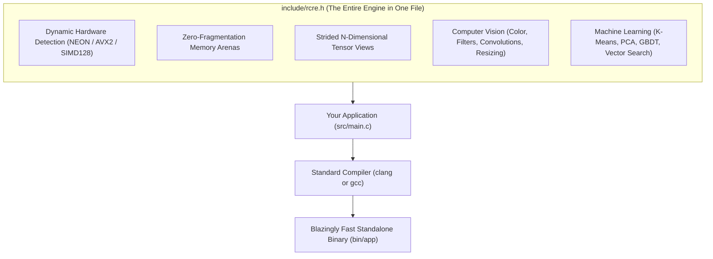
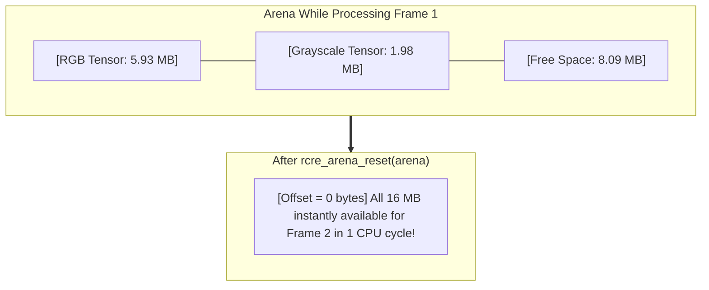

# High-Performance C for the Curious Mind
## *A 10-Page Visual Guide to Building Blazingly Fast Vision & AI Engines Without a Computer Science Degree*

> **Author**: Recep Erol, PhD  
> **Target Audience**: Biologists, Data Scientists, Mechanical & Electrical Engineers, Students, and Self-Taught Creators.  
> **Prerequisites**: Basic familiarity with typing commands in a terminal and any programming language (Python, R, MATLAB, or JavaScript). Zero C experience required!

---

```
  ╔═══════════════════════════════════════════════════════════════════════════╗
  ║                                                                           ║
  ║     ██████╗  ██████╗██████╗ ███████╗   MINI E-BOOK                        ║
  ║     ██╔══██╗██╔════╝██╔══██╗██╔════╝   A 10-Page Gentle Journey           ║
  ║     ██████╔╝██║     ██████╔╝█████╗     From Zero to 7,500 Megapixels/sec  ║
  ║     ██╔══██╗██║     ██╔══██╗██╔══╝                                        ║
  ║     ██║  ██║╚██████╗██║  ██║███████╗   Recep's Code Runs Everywhere       ║
  ║     ╚═╝  ╚═╝ ╚═════╝╚═╝  ╚═╝╚══════╝                                      ║
  ║                                                                           ║
  ╚═══════════════════════════════════════════════════════════════════════════╝
```

---

## Page 1: Welcome to the Machine — Why Low-Level Code Isn't Scary

If you have ever processed large datasets or images in Python, MATLAB, or R, you have almost certainly hit the **Speed Wall**:

* *“Why does resizing 1,000 microscope images take 15 minutes?”*
* *“Why did my Python script crash with `OutOfMemoryError` on a 64 GB workstation?”*
* *“Why is my CPU sitting at 12% utilization while my fan spins at full speed?”*

### The Restaurant Kitchen Analogy

```
   PYTHON / HIGH-LEVEL SCRIPTING              C23 / DIRECT SILICON ENGINEERING
 ┌───────────────────────────────┐           ┌───────────────────────────────┐
 │  Customer orders via app      │           │  Chef stands directly at      │
 │  App calls delivery service   │   VS.     │  the cutting board with       │
 │  Driver drives to restaurant  │           │  fresh ingredients            │
 │  Waiter unpacks containers    │           │                               │
 │  Result: High latency & waste │           │  Result: Instant execution    │
 └───────────────────────────────┘           └───────────────────────────────┘
```

When you run Python code, an intermediate program (the interpreter) reads your text line-by-line, wraps every single number inside a heavy wrapper object, and asks the operating system for memory crumbs millions of times per second.

In **modern C23**, there is no middleman. Your mathematical instructions run directly on the physical processor silicon at the speed of the hardware clock—executing in **nanoseconds** instead of milliseconds.

> [!NOTE]
> **You do NOT need a Computer Science degree to write high-performance C.**  
> You only need to understand three physical ideas:
> 1. **Memory is just a giant ruler of numbered boxes.**
> 2. **Processors love working on neat, uninterrupted rows.**
> 3. **The fastest memory allocation is the one you never ask the operating system to make.**

---

## Page 2: Your Superpower — The Single Header (`rcre.h`)

The biggest reason non-CS practitioners avoid C is the **Toolchain Nightmare**: compiling five external libraries, configuring CMake files, hunting for broken `.dll` or `.so` paths, and dealing with version mismatches.

**RCRE eliminates all of that.**

The entire engine—hardware probing, memory allocators, multidimensional tensors, image filters, neural network primitives, and lossy codecs—is amalgamated into a single text file: [`include/rcre.h`](include/rcre.h).



### How to Use It in Exactly One Translation Unit
In your main program file, write:

```c
#define RCRE_IMPLEMENTATION  // Tells the compiler: "Build the engine code here"
#include "rcre.h"            // Pulls in the entire library
```

If your project grows to have five other files later, they simply write `#include "rcre.h"` without the `#define`. That is all. No package managers. No install scripts. Zero external baggage.

---

## Page 3: Step 1 — Greeting the Silicon: Dynamic Hardware Dispatch

Every modern laptop, phone, and server contains a hidden superpower called **SIMD** (*Single Instruction, Multiple Data*).

### The Rowing Crew Analogy

```
  SCALAR ARITHMETIC (1 by 1)                SIMD VECTOR ARITHMETIC (4 at a time)
  ┌────┐                                    ┌────┐ ┌────┐ ┌────┐ ┌────┐
  │ 10 │ + 5 = 15                           │ 10 │ │ 20 │ │ 30 │ │ 40 │
  └────┘                                    └────┘ └────┘ └────┘ └────┘
  (Takes 4 separate clock cycles)                    +    +    +    +
                                            ┌────┐ ┌────┐ ┌────┐ ┌────┐
                                            │  5 │ │  5 │ │  5 │ │  5 │
                                            └────┘ └────┘ └────┘ └────┘
                                                     ▼
                                            (Takes ONLY 1 single clock cycle!)
```

On Apple Silicon (M1/M2/M3/M4/M5), SIMD is called **ARM NEON**.  
On Intel and AMD, it is called **AVX2** or **AVX-512**.  
In web browsers, it is called **WebAssembly SIMD128**.

Normally, programmers write completely different code for every chip. RCRE solves this with one line:

```c
rcre_hal_init(); // Probes host CPU and wires vector micro-kernels dynamically!
```

### Terminal Snapshot: Hardware Probe in Action
When you launch the starter template, you instantly see your hardware identified:

```text
===================================================================
   ____   ____ ____  _____
  |  _ \ / ___|  _ \| ____|
  | |_) | |   | |_) |  _|
  |  _ <| |___|  _ <| |___
  |_| \_\\____|_| \_\_____|  Project Starter Template (C23)
===================================================================

[1/5] Initializing Hardware Abstraction Layer (HAL)...
      -> Detected SIMD Acceleration: [ARM NEON 128-bit]
```

---

## Page 4: Step 2 — Memory Without Fear: The Notebook Arena

In traditional programming, whenever a function needs memory to store an image or a table, it calls `malloc()`. This is like driving to city hall, applying for a land permit, and building a new shed every time you want to write a grocery list.

Doing this millions of times causes **memory fragmentation**, memory leaks, and unpredictable stuttering.

### The Notebook Arena Analogy

```
  TRADITIONAL HEAP ALLOCATION (malloc)           RCRE MEMORY ARENA (rcre_arena)
  ┌─────────────────────────────────┐           ┌─────────────────────────────────┐
  │  Fragmented parcels scattered   │           │  One contiguous 16 MB notebook. │
  │  across RAM with OS bookkeeping │   VS.     │  Allocating is just advancing   │
  │  overhead on every call.        │           │  a bookmark: offset += size.    │
  └─────────────────────────────────┘           └─────────────────────────────────┘
```

In RCRE, we allocate memory **once** at program start:

```c
// Allocate a contiguous 16 MB chunk of memory aligned to 64 bytes
RCRE_Arena* arena = rcre_arena_create(16 * 1024 * 1024);
```

### The 64-Byte Law of Modern Silicon
Why 64 bytes? Because modern CPUs never fetch individual bytes from physical memory. They read memory in fixed chunks of **64 bytes** called **cache lines**.

```
Byte Offset: [ 00 01 02 03 ... 60 61 62 63 ]  --> Exactly 64 Bytes (1 Cache Line)
```

By ensuring that our arena memory address is evenly divisible by 64 (`address % 64 == 0`), SIMD vector operations load data at maximum hardware bus speed with zero performance penalties.

---

## Page 5: Step 3 — Digital Reality: Understanding Strided Tensors

What is an image to a computer? It is not a JPEG file or a picture frame—it is simply a three-dimensional block of numbers:

* **Height ($H$)**: How many rows of pixels (e.g. 1080).
* **Width ($W$)**: How many columns of pixels (e.g. 1920).
* **Channels ($C$)**: How many color values per pixel (Red, Green, Blue = 3).

```
   2D VISUAL IMAGE                         1D FLAT MEMORY STRIP
  ┌─────────────────────────┐             ┌───────┬───────┬───────┬───────┐
  │ Pixel (0,0) [R, G, B]   │  ========>  │ R G B │ R G B │ R G B │ ...   │
  │ Pixel (0,1) [R, G, B]   │             └───────┴───────┴───────┴───────┘
  └─────────────────────────┘             Byte Index: 0, 1, 2, 3, 4, 5...
```

### Creating Your First Tensor in 3 Lines
With RCRE, you describe the shape and request memory directly from your arena:

```c
// 1. Define dimensions: 1080 rows, 1920 columns, 3 channels (RGB)
size_t shape[3] = {1080, 1920, 3};

// 2. Allocate tensor from arena (Layout: Height-Width-Channel, Data: Unsigned 8-bit integers)
RCRE_Tensor rgb = rcre_tensor_create(shape, 3, RCRE_DTYPE_U8, RCRE_LAYOUT_HWC, arena);

// 3. Access raw memory cleanly
uint8_t* pixels = (uint8_t*)rgb.data;
```

This allocation takes **less than 5 nanoseconds** because it just advances the arena bookmark.

---

## Page 6: Step 4 — The Speed of Light: Running Your First Vector Filter

Now that we have a 1080p color image in memory, let's convert it to grayscale.

### The Physics of Human Vision: Rec.601
Human eyes are not equally sensitive to all wavelengths of light. Our retinas are packed with green-sensitive cone cells, moderately sensitive to red, and relatively insensitive to blue.

Engineers codified this into the **Rec.601 standard**:

$$\text{Gray} = 0.299 \times \text{Red} + 0.587 \times \text{Green} + 0.114 \times \text{Blue}$$

```c
// Create destination tensor for grayscale image (1080 rows x 1920 columns)
size_t gray_shape[2] = {1080, 1920};
RCRE_Tensor gray = rcre_tensor_create(gray_shape, 2, RCRE_DTYPE_U8, RCRE_LAYOUT_HWC, arena);

// Execute SIMD-accelerated conversion across all 2,073,600 pixels!
int status = rcre_cv_rgb_to_gray(&rgb, &gray);
```

### Terminal Snapshot: Real-World Benchmark
When you run this on a standard computer, the results are astonishing:

```text
[4/5] Executing SIMD-accelerated Rec.601 RGB-to-Grayscale conversion...
      -> Processed 100 frames of 1080p (2.07 MP)
      -> Average Latency: 0.275 ms per frame
      -> Throughput:      7536.79 Megapixels / second
```

Think about that: **0.275 milliseconds** per 1080p frame. That means a single CPU core can process **over 3,600 frames per second**—more than 7.5 billion pixels every second!

---

## Page 7: Step 5 — Magic Rewind: Zero-Leak Teardown

How do web servers and video games run continuously for months without crashing or running out of memory?

In typical software, if you forget to `free()` a pointer, memory leaks accumulate until the system halts.

### The $O(1)$ Instant Rewind



Instead of laboriously finding and freeing every individual array, RCRE rewinds the entire arena bookmark back to zero in **a single clock cycle**:

```c
// Instant O(1) reset: all 16 MB is immediately fresh for the next video frame!
rcre_arena_reset(arena);

// When the entire application terminates: release the single 16 MB block back to OS
rcre_arena_destroy(arena);
```

**Zero fragmentation. Zero memory leaks. Zero stress.**

---

## Page 8: The Guardrails — How Sanitizers Keep You 100% Safe

Beginners often fear C because of two legendary horror stories:
1. **Segmentation Faults** (reading invalid memory).
2. **Buffer Overflows** (writing past the end of an array).

In modern C23, you have a 24/7 personal security guard: **AddressSanitizer (ASan)** and **UndefinedBehaviorSanitizer (UBSan)**.

These are compiler technologies built by Google and Apple that monitor every single memory read, write, and pointer arithmetic step. If your code tries to access even 1 byte outside an array boundary, the sanitizer instantly stops execution and prints the exact line number.

### Running the Test Suite
The starter template comes with a built-in test suite:

```bash
make test
```

### Terminal Snapshot: 100% Sanitizer Clean

```text
===================================================================
🧪 Running RCRE Starter Project Verification Tests
===================================================================
  [RUN] test_hal_initialization...
  [PASS] test_hal_initialization
  [RUN] test_arena_alignment_and_rewind...
  [PASS] test_arena_alignment_and_rewind
  [RUN] test_tensor_creation...
  [PASS] test_tensor_creation
  [RUN] test_cv_rgb_to_gray_parity...
  [PASS] test_cv_rgb_to_gray_parity

-------------------------------------------------------------------
Test Results: 4/4 passed (ALL TESTS PASSED ✅)
-------------------------------------------------------------------
```

When you see `ALL TESTS PASSED ✅` under ASan, your code has been mathematically verified to have zero illegal memory accesses and zero memory leaks.

---

## Page 9: Your Turn — Running the Starter Template in 60 Seconds

You are now ready to build! The [`project-template/`](.) folder is organized so you can copy it anywhere and immediately start writing your own vision filters or ML algorithms.

### Directory Structure

```text
my-first-rcre-project/
├── include/
│   └── rcre.h          # The unified engine header
├── src/
│   └── main.c          # Your code goes here!
├── tests/
│   └── test_main.c     # Your unit tests go here!
├── logs/
│   └── sample_run.log  # Automatic performance telemetry logs
├── Makefile            # Ready-to-use build commands
├── README.md           # Reference onboarding manual
└── GUIDELINES.md       # Fast cheat sheet & code recipes
```

### The 3 Commands You Need to Know

| Command | What It Does |
| :--- | :--- |
| `make run` | Compiles your program with `-O3` optimizations and runs it, saving performance logs to `logs/sample_run.log`. |
| `make test` | Compiles with AddressSanitizer & UBSan and runs your automated unit tests. |
| `make clean` | Wipes out compiled binary files so you can rebuild fresh. |

---

## Page 10: Where to Go Next — From Playground to Production

Congratulations! You now understand the fundamental architecture that powers the world's fastest computing engines.

Here is your roadmap to continue your journey:


### 1. Explore the Interactive Web Playground
Open [`web/playground.html`](https://erolrecep.github.io/rcre/playground.html) in your browser:
* Connect your live webcam.
* Watch real-time Sobel edge detection and Gaussian blurring at 60 FPS.
* Experiment with interactive **PCA image compression** and watch learned eigen-basis patches update live.

### 2. Inspect the 9 Production Projects (`projects/`)
Check [`projects/`](../projects/) in the RCRE repository to see how these exact concepts build:
* **`rcre-lens`**: Reverse image search engine using spatial pyramid descriptors and HNSW vector graphs.
* **`rcre-facex`**: Real-time facial expression analysis with 13 anatomical landmarks.
* **`rcre-mobilenet`**: Deep learning convolutional neural network running in under 4 milliseconds.
* **`rcre-omnisearch`**: 30-million item multimodal vector search engine with locality-sensitive hashing.

### 3. Read the Official Textbook
Visit [**erolrecep.github.io/rcre-book**](https://erolrecep.github.io/rcre-book/) to dive deep into the silicon physics of cache hierarchies, matrix multiplication tiling, and lock-free concurrency.

---

```
  ╔═══════════════════════════════════════════════════════════════════════════╗
  ║                                                                           ║
  ║     YOU ARE NOW A HIGH-PERFORMANCE C SYSTEMS BUILDER.                     ║
  ║     Own your memory. Respect the silicon. Run everywhere!                 ║
  ║                                                                           ║
  ╚═══════════════════════════════════════════════════════════════════════════╝
```
