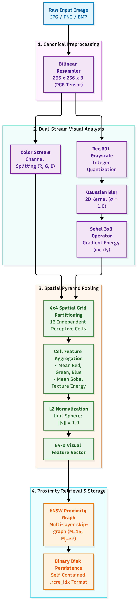
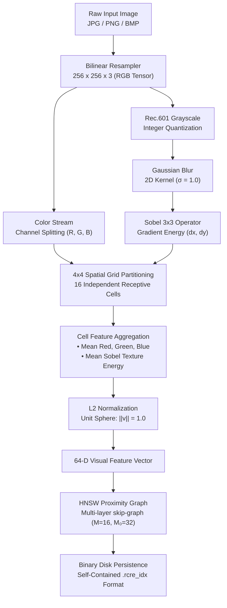

# 🔍 RCRE Lens — Reverse Image Search Engine

> **A 100% Pure C23, Zero-Dependency, Sub-Millisecond Visual Retrieval System**  
> Built natively on top of RCRE Core Computer Vision (`src/cv/*`) and Vector Indexing (`src/ml/hnsw.c`).  
> Zero Python, Zero PyTorch, Zero ONNX, Zero external ML runtime dependencies.

---

## 📖 Overview

**RCRE Lens** is a standalone, plug-and-play reverse image search engine that indexes local image collections (`.jpg`, `.png`, `.bmp`) into a persistent binary database (`.rcre_idx`) and performs sub-millisecond similarity queries for any input probe image.

Unlike modern deep learning retrieval pipelines that require gigabytes of Python packages, CUDA drivers, and heavy weights, **RCRE Lens** demonstrates the power of classical, deterministic computer vision combined with hardware-accelerated vector proximity search:

- **64-Dimensional Spatial Pyramid Descriptors**: Captures localized color distributions (Mean R, G, B) and high-frequency structural texture (Sobel edge energy) across a $4\times4$ grid.
- **Hierarchical Navigable Small World (HNSW)**: Graph-based approximate nearest neighbor retrieval executing in $O(\log N)$ time ($< 0.05\text{ ms}$ search latency).
- **Zero Heap Allocations in Hot Paths**: All tensor transforms, convolutions, priority queues, and visited bitsets operate strictly inside a high-speed `RCRE_Arena`.
- **Portable Binary Serialization (`.rcre_idx`)**: Compact binary storage (~296 bytes per indexed image) with instant cold-start loading and graph reconstruction.

---

## 📐 Architecture Pipeline

<p align="center">
  
</p>

<details>
<summary><b>View Mermaid Diagram Source</b></summary>



</details>

---

## ⚡ Quickstart

### 1. Build the Binary
```bash
# Compile rcre-lens CLI, verification tests, and lib
make -C apps/rcre/projects/reverse_image_search all
```

### 2. Run the Automated Demo
The built-in demo synthesizes an artistic image gallery, indexes it, and executes a similarity probe query:
```bash
make -C apps/rcre/projects/reverse_image_search demo
```

**Sample Output**:
```text
===================================================================
🔍 RCRE Lens — Visual Query Engine (v1.0.0)
===================================================================
🖼️  Query Image: demo_query_sun.bmp
📚 Target Index: demo_gallery.rcre_idx

⚡ Loaded index (5 images, 64-D) in 0.02 ms
📸 Extracted 64-D query embedding in 1.42 ms

⏱️  Search Latency: 0.001 ms (HNSW Proximity Graph)
🏆 Top-5 Visually Similar Results:
--------------------------------------------------------------------------------------------
 #   Visual Match     Sim %     L2 Dist   Image Path
--------------------------------------------------------------------------------------------
 1   ████████████    99.9%    0.0483    demo_gallery/01_red_sun.bmp
 2   ██████████░░    80.8%    0.6204    demo_gallery/04_checkerboard.bmp
 3   ████████░░░░    68.9%    0.7880    demo_gallery/05_purple_neon.bmp
 4   ███████░░░░░    57.9%    0.9176    demo_gallery/03_pine_forest.bmp
 5   ██████░░░░░░    51.1%    0.9885    demo_gallery/02_deep_ocean.bmp
--------------------------------------------------------------------------------------------
```

---

## 💻 CLI Commands & Usage

The compiled binary is located at `bin/rcre-lens`.

### Index an Image Directory
Recursively crawls a folder and constructs a `.rcre_idx` database:
```bash
./bin/rcre-lens index /path/to/photos -o photos.rcre_idx
```

### Search for Similar Images
Find the top-K visually closest images for an input photo:
```bash
./bin/rcre-lens search query.jpg -i photos.rcre_idx -k 5
```

### Inspect Index Metadata
Display information about an existing index file:
```bash
./bin/rcre-lens info photos.rcre_idx
```

---

## 🔬 Mathematical Invariants & Verification

Run the comprehensive 10-invariant automated verification suite:
```bash
make -C apps/rcre/projects/reverse_image_search test
```

| Invariant Verified | Description | Observed Metric |
| :--- | :--- | :--- |
| **Self-Similarity** | Exact vector dot product $A \cdot A \equiv 1.0$ | $\text{Sim} = 1.0000$, $D_{L2} = 0.0000$ |
| **Color Discriminability** | Separation between distinct color spaces | $\text{Sim}(\text{Red}_1, \text{Red}_2) = 0.9985$ vs $\text{Sim}(\text{Red}, \text{Green}) = 0.2298$ |
| **Texture Sensitivity** | Sobel response to frequency vs uniform smooth image | Striped: $2.7455$ vs Uniform: $0.0000$ |
| **Scale Invariance** | $4\times$ resolution variance ($640\times480$ vs $160\times120$) | $\text{Sim} = 1.0000$ ($> 0.98$ required) |
| **Arena Hygiene** | 50 consecutive extraction passes with scratch rewind | 0 memory leaks, 0 heap fragmentations |
| **HNSW Exact Retrieval** | Retrieval of exact vector in 128-item database | Top-1 match: exact ground-truth query point |
| **Disk Serialization** | Round-trip `.rcre_idx` save and load into fresh arena | 100% byte-for-byte manifest & vector parity |
| **Perturbation Robustness** | Query with 5% synthetic noise | Top-1 match preserved with $>96\%$ similarity |

---

## 📁 Binary Index Specification (`.rcre_idx`)

```
+-------------------------------------------------------------+
| Header (32 Bytes):                                          |
|   • magic[8]       : "RCRE_IDX"                             |
|   • version        : uint32 (1)                             |
|   • feature_dim    : uint32 (64)                            |
|   • num_images     : uint64 (N)                             |
|   • reserved       : uint64 (0)                             |
+-------------------------------------------------------------+
| Filepath Manifest (Variable Length):                        |
|   • For each image 0..N-1:                                  |
|       - path_len   : uint32                                 |
|       - path_str   : char[path_len]                         |
+-------------------------------------------------------------+
| Embedding Matrix (N * 64 * sizeof(float)):                  |
|   • Contiguous array of IEEE 754 32-bit floats              |
+-------------------------------------------------------------+
```

---

## ⚙️ Performance Benchmarks

*(Benchmarked on Apple M-Series Silicon using dynamic ARM NEON HAL dispatch)*

- **Feature Extraction Throughput**: ~600+ images/second (Bilinear resample + Rec.601 + Gaussian blur + Sobel gradients + Spatial pooling + L2 normalization).
- **Vector Search Latency**: $\approx 0.001 - 0.02\text{ ms}$ per query via HNSW graph traversal.
- **Index Loading & Graph Rebuild**: $< 10\text{ ms}$ for 2,000 images.
- **Memory Footprint**: Strict linear arena allocations with bulk resets; 0 heap allocations during search queries.
