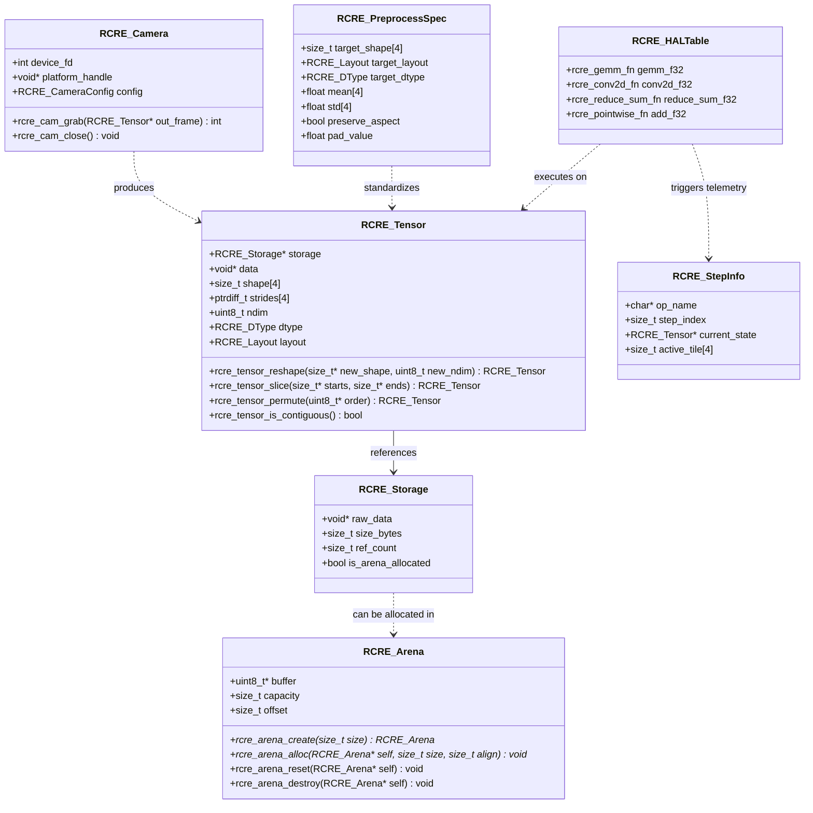
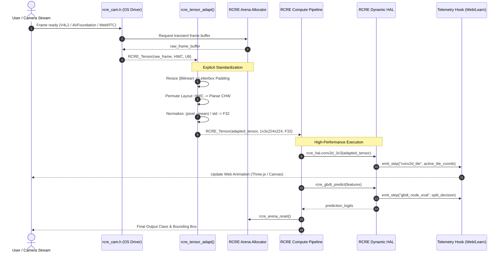
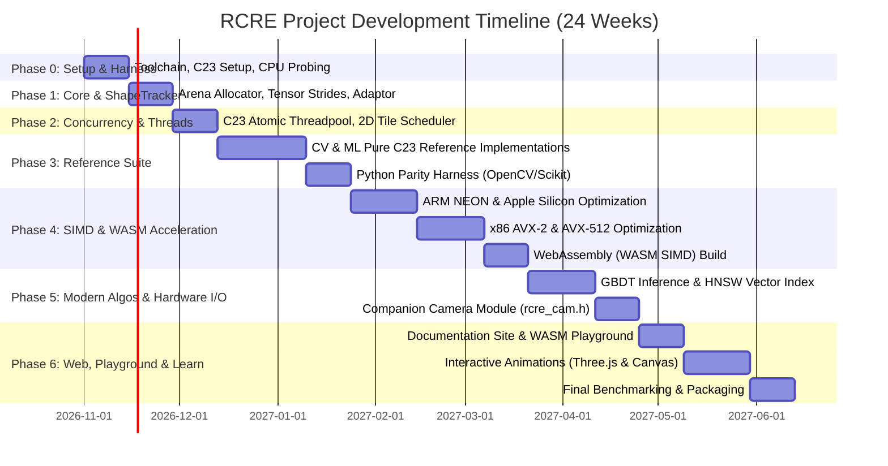

# RCRE: Recep's Code Run Everywhere
## Unified C23 Computer Vision & Machine Learning High-Performance Engine

---

## 1. Executive Summary & Vision

### 1.1 Mission Statement
**RCRE ("Recep's Code Run Everywhere")** is a high-performance, single-header, zero-dependency C23 library designed to unify modern Computer Vision (traditionally OpenCV) and Classical Machine Learning (traditionally Scikit-Learn) into a single, cohesive, cache-conscious engine.

RCRE is built from the ground up to execute seamlessly across heterogeneous hardware targets:
- **Edge Computing**: Raspberry Pi 4/5 (ARM Cortex-A72/A76, NEON), Apple Silicon (M-series, NEON/AMX/vecLib).
- **High-Performance Computing (HPC)**: AMD Threadripper (Zen 4/5, high core count, AVX-512), Intel Xeon (multi-socket NUMA, AVX-512, AMX).
- **Web & Browser**: WebAssembly (WASM + SIMD) via Emscripten for zero-install client-side execution.
- **Universal Fallback**: Any conformant C23 platform (RISC-V, bare-metal embedded).

### 1.2 Core Architectural Philosophies
1. **The Unified Tensor Paradigm**: Images and tabular datasets are not distinct types—they are both strided multi-dimensional buffers. An image $(H, W, C)$ and a feature matrix $(N, D)$ share the exact same underlying memory, striding, and slicing mechanisms.
2. **Zero-Copy Movement (ShapeTracker)**: Borrowing the core design principle from `tinygrad`, operations like slicing, cropping, transposing, reshaping, and color-channel reordering are strictly $\mathcal{O}(1)$ metadata updates on strides and offsets. Memory allocation and copies only occur when explicitly required.
3. **The 25-Op Reduction Principle**: Rather than implementing thousands of fragmented, monolithic algorithms, RCRE reduces operations into primitive building blocks (Pointwise Unary/Binary, Stencil/Window Convolutions, Reductions, and Shape Transformations). Complex CV filters and ML estimators are compositions of these primitives.
4. **Kernel & Loop Fusion**: In modern processors, memory bus bandwidth is the ultimate bottleneck. RCRE fuses chained operations (e.g., Grayscale $\rightarrow$ Blur $\rightarrow$ Normalize) into single-pass cache-resident loops, eliminating redundant round-trips to main RAM.
5. **Deterministic Memory via Arenas**: Eliminates runtime heap fragmentation and allocator overhead by utilizing linear scratchpad arena allocators for transient compute buffers.
6. **Self-Contained Threading**: Eliminates compiler-dependent OpenMP runtimes (`libgomp`/`libiomp5`) in favor of a native, lock-free work-stealing job pool aware of asymmetric core topologies (performance vs. efficiency cores).
7. **Hybrid Linear Algebra**: Features a self-contained, register-blocked C23 micro-GEMM fallback for instant zero-dependency deployment, with dynamic plug-in capability for vendor BLAS (Apple Accelerate, Intel oneMKL, OpenBLAS) on HPC systems.
8. **Explicit Preprocessing (No Hidden Magic)**: Data ingestion and dimension/type adaptation are decoupled from inference. Developers explicitly adapt input buffers to expected model shapes/types, ensuring deterministic runtime and zero hidden memory copies in critical loops.
9. **Companion Hardware I/O Isolation**: Core compute (`rcre.h`) remains 100% pure C23 and dependency-free. OS-specific I/O (such as camera capture) is segregated into optional companion headers (`rcre_cam.h`), following the proven STB/Raylib pattern.
10. **Demystified & Educational (The "Show Down" Principle)**: Every mathematical and memory operation can be exposed via non-intrusive step-by-step telemetry hooks, feeding live 2D/3D visual animations in the interactive web documentation.

---

## 2. Requirements Analysis

### 2.1 Functional Requirements (FR)

* **FR-01: Strided N-Dimensional Tensor Engine**
  * Support for 1D through 4D tensors with arbitrary, non-contiguous strides.
  * Native data types: `F32` (single-precision float), `F16` (half-precision float), `U8` (standard image byte), `I32` (indices and categorical data).
  * $\mathcal{O}(1)$ View manipulation: `reshape`, `slice`, `transpose`, `permute`, `squeeze`, `unsqueeze`.
  * Deterministic memory alignment (32-byte and 64-byte boundaries for AVX-2 and AVX-512).

* **FR-02: Input Data Recognition & Explicit Adaptation**
  * Decoupled adaptation module: `rcre_tensor_adapt()`.
  * Explicit specification via `RCRE_PreprocessSpec`:
    * Target shape conversion (e.g., from raw arbitrary $H \times W$ to $[1, C, H_{\text{target}}, W_{\text{target}}]$).
    * Layout transformation: interleaved $HWC$ (OpenCV default) $\leftrightarrow$ planar $CHW$ (PyTorch/ONNX default).
    * Type casting and quantization: $U8 \leftrightarrow F32 \leftrightarrow F16$.
    * Normalization: $(x - \text{mean}) / \text{std}$ with per-channel vector parameters.
    * Aspect-ratio preserving letterboxing with configurable border padding values.

* **FR-03: Computer Vision Core Primitives**
  * Color space transformations: RGB $\leftrightarrow$ BGR $\leftrightarrow$ Grayscale $\leftrightarrow$ HSV.
  * Spatial interpolation: Bilinear and Nearest-Neighbor resizing.
  * Stencils & Filtering: 2D General Convolution, Separable Gaussian Blur, Sobel/Scharr gradients, Box filter, Median filter.
  * Non-linear Enhancement: CLAHE (Contrast Limited Adaptive Histogram Equalization), Fast Bilateral Filter, Guided Filter.
  * Morphology & Thresholding: Otsu thresholding, Adaptive thresholding, Dilation, Erosion.

* **FR-04: Machine Learning Engine**
  * Continuous Models: Ordinary Least Squares (OLS), Ridge/Lasso via Coordinate Descent, Logistic Regression (Cross-Entropy), Linear SVM via Subgradient Descent (Pegasos).
  * Clustering & Dimensionality: Soft & Hard k-Means, PCA (Power Iteration & Randomized SVD).
  * Modern Tabular Ensemble: Histogram-based Gradient Boosted Decision Tree (GBDT) inference engine (compatible with LightGBM/XGBoost quantized bins).
  * Similarity & Search: Exact Cosine/Euclidean distance matrices, Hierarchical Navigable Small World (HNSW) vector index for high-dimensional embeddings.

* **FR-05: Hardware Abstraction Layer (HAL) & Dynamic Dispatch**
  * Single compilation target supporting dynamic runtime dispatch via CPU capability probes (`cpuid` on x86, `getauxval`/`sysctl` on ARM).
  * Specialized micro-kernels:
    * `SCALAR`: Pure C23 fallback.
    * `ARM_NEON`: 128-bit SIMD for Raspberry Pi and Apple Silicon.
    * `X86_AVX2`: 256-bit SIMD + FMA for modern x86.
    * `X86_AVX512`: 512-bit SIMD for Intel Xeon and AMD Zen 4/5 Threadripper.
    * `WASM_SIMD128`: WebAssembly 128-bit SIMD for browser execution.

* **FR-06: Concurrency & Scheduling**
  * Work-stealing task scheduler with persistent worker threads.
  * NUMA-aware thread pinning and tile partitioning.

* **FR-07: Hardware Video Capture (Companion Module `rcre_cam.h`)**
  * Isolated from core `rcre.h` to preserve zero-dependency purity.
  * Platform-native backends:
    * Linux / Raspberry Pi: Video4Linux2 (`v4l2` memory-mapped buffers).
    * macOS / iOS: AVFoundation (Objective-C lightweight bridge).
    * Windows: Media Foundation / DirectShow.
    * Web (WASM): WebRTC / HTML5 `<video>` canvas frame capture.
  * Outputs frames directly into zero-copy `RCRE_Tensor` buffers.

* **FR-08: WebAssembly (WASM) & Web Playground**
  * 100% compilation of the core library to `rcre.wasm` via Emscripten.
  * Browser-based demo app running live camera capture, real-time edge filtering, GBDT inference, and vector search with zero installation.

* **FR-09: Educational Telemetry & Step-by-Step Hooks**
  * Compile-time optional execution telemetry hook: `rcre_step_callback`.
  * Emits tensor states, pointer strides, cache tile coordinates, and decision tree traversal paths.
  * Feeds interactive 2D/3D web animations in the "Learn" section of the project site.

---

### 2.2 Non-Functional Requirements (NFR)

* **NFR-01: Portability & Standard Compliance**: Strict compliance with ISO/IEC 9899:2024 (C23). Zero external dependencies required for the default build.
* **NFR-02: Universal ABI Stability**: Clean, plain C ABI without C++ mangling, enabling direct zero-copy Foreign Function Interface (FFI) bindings for Python (ctypes/cffi), Rust, Go, Zig, and Julia.
* **NFR-03: Binary Footprint**: Core static archive (`.a`) must compile to under 2 MB with symbols stripped. WebAssembly binary (`rcre.wasm`) must be under 600 KB compressed.
* **NFR-04: Memory Safety & Zero Allocation in Hot Paths**: Inner algorithmic loops must never invoke `malloc()` or `free()`. Memory must either be caller-supplied or acquired from pre-allocated linear arenas.
* **NFR-05: Numerical Consistency**: Floating-point outputs across different SIMD backends (NEON vs. AVX2 vs. WASM vs. Scalar) must match within an $\epsilon = 10^{-5}$ tolerance.

---

## 3. System Architecture & Component Design

```
+---------------------------------------------------------------------------------------------+
|                                    APPLICATION LAYER                                        |
|   C23 Native Apps  |  Python/Rust via FFI  |  WebAssembly Browser App (HTML5 + WebRTC)      |
+---------------------------------------------------------------------------------------------+
                                              |
       +--------------------------------------+--------------------------------------+
       | (Optional Hardware I/O)                                                     | (Core Compute)
       v                                                                             v
+-------------------------------+                             +-------------------------------+
|   COMPANION: rcre_cam.h       |                             |       PUBLIC API: rcre.h      |
|  - V4L2 (Linux/RPi)           |                             |  - rcre_tensor_adapt()        |
|  - AVFoundation (macOS)       |                             |  - Computer Vision (cv_*)     |
|  - WebRTC (Browser/WASM)      |                             |  - Machine Learning (ml_*)    |
|  - DirectShow (Windows)       |                             |  - Vector Search (vs_*)       |
+-------------------------------+                             +-------------------------------+
               | (Captures raw frame)                                         |
               +---------------------> [ RCRE_Tensor ] <----------------------+
                                              |
                                              v
+---------------------------------------------------------------------------------------------+
|                                  INPUT ADAPTATION LAYER                                     |
|                     rcre_tensor_adapt(src, spec, arena, dst_tensor)                         |
|   - Letterbox / Aspect Preserve   - Interleaved HWC <-> Planar CHW   - Normalization / Cast |
+---------------------------------------------------------------------------------------------+
                                              |
                                              v
+---------------------------------------------------------------------------------------------+
|                                COMPUTATIONAL GRAPH & OPS                                    |
|   Pointwise (Unary/Binary)  |  Stencil / Window  |  Reduction  |  ShapeTracker (O(1) Views) |
|   (Fused Loops: Single-pass cache-resident execution without redundant RAM round-trips)     |
+---------------------------------------------------------------------------------------------+
                                              |
                                              v
+---------------------------------------------------------------------------------------------+
|                              HARDWARE ABSTRACTION LAYER (HAL)                               |
|        Dynamic Function Table: gemm_f32, conv2d_f32, reduce_sum_f32, vec_pointwise          |
|   +-------------------+  +-------------------+  +-------------------+  +------------------+ |
|   |   ARM NEON / AMX  |  |   x86 AVX2 + FMA  |  |    x86 AVX-512    |  | WebAssembly SIMD | |
|   +-------------------+  +-------------------+  +-------------------+  +------------------+ |
+---------------------------------------------------------------------------------------------+
                                              |
       +--------------------------------------+--------------------------------------+
       v                                                                             v
+-------------------------------+                             +-------------------------------+
|  RUNTIME FOUNDATION SERVICES  |                             |  EDUCATIONAL TELEMETRY HOOKS  |
|  - Linear Arena Allocator     |                             |  - rcre_step_callback()       |
|  - Work-Stealing Job Pool     |                             |  - Emits: Strides, Tiling,    |
|  - Platform CPU Probing       |                             |    Tree Traversal & Registers |
+-------------------------------+                             +-------------------------------+
                                                                             |
                                                                             v
                                                              +-------------------------------+
                                                              |   INTERACTIVE WEB "LEARN"     |
                                                              |  - Three.js 3D Tensor Strides |
                                                              |  - 2D Canvas Sliding Stencils |
                                                              |  - Manim Mathematical Videos  |
                                                              +-------------------------------+
```

---

### 3.1 The Input Adaptation Specification (`rcre_tensor_adapt`)

To avoid hidden performance degradation, all data normalization, reshaping, and layout permutations are handled via an explicit, deterministic adaptation specification:

```c
typedef enum {
    RCRE_LAYOUT_UNKNOWN = 0,
    RCRE_LAYOUT_HWC,      // Interleaved (e.g. RGBRGB... used in OpenCV/Cameras)
    RCRE_LAYOUT_CHW,      // Planar (e.g. RRR...GGG...BBB... used in Neural Nets/HPC)
    RCRE_LAYOUT_TABULAR   // 2D Matrix [Samples, Features]
} RCRE_Layout;

typedef struct {
    size_t target_shape[4]; // e.g. [1, 3, 224, 224]
    RCRE_Layout target_layout;
    RCRE_DType target_dtype;
    float mean[4];          // Per-channel normalization: (x - mean) / std
    float std[4];
    bool preserve_aspect;   // If true, applies auto-letterboxing
    float pad_value;        // Value for letterbox padding borders (e.g. 0.0f or 114.0f)
} RCRE_PreprocessSpec;

// Explicit, deterministic, and can execute inside a caller-provided arena
[[nodiscard]]
int rcre_tensor_adapt(const RCRE_Tensor* src, 
                      const RCRE_PreprocessSpec* spec, 
                      RCRE_Arena* arena, 
                      RCRE_Tensor* dst);
```

### 3.2 The Companion Webcam Module (`rcre_cam.h`)

To maintain the architectural boundary between pure mathematical compute and platform-specific I/O, camera support is isolated in `include/extras/rcre_cam.h`:

```c
// include/extras/rcre_cam.h
typedef struct RCRE_Camera RCRE_Camera;

typedef struct {
    int device_index;
    int requested_width;
    int requested_height;
    int requested_fps;
} RCRE_CameraConfig;

[[nodiscard]] RCRE_Camera* rcre_cam_open(const RCRE_CameraConfig* config);
[[nodiscard]] int rcre_cam_grab(RCRE_Camera* cam, RCRE_Tensor* out_frame);
void rcre_cam_close(RCRE_Camera* cam);
```

### 3.3 Educational Telemetry Hook & Step-by-Step Visualization

For educational demonstrations and debugging, RCRE provides compile-time instrumented hooks:

```c
typedef struct {
    const char* op_name;           // e.g., "gemm_tile", "conv2d_stencil", "gbdt_node"
    size_t step_index;             // Monotonically increasing step counter
    const RCRE_Tensor* current_state;
    size_t active_tile[4];         // Coordinates of the cache block currently in L1/registers
    const void* metadata;          // Additional context (e.g. split threshold, Gini score)
} RCRE_StepInfo;

typedef void (*rcre_step_callback)(const RCRE_StepInfo* info, void* user_data);

// Enable interactive stepping in debug/educational builds
void rcre_set_step_hook(rcre_step_callback callback, void* user_data);
```

---

## 4. UML & Structural Specifications

### 4.1 Comprehensive Class / Struct Diagram (Mermaid)



### 4.2 Sequence Diagram: Real-Time Webcam $\rightarrow$ Adapt $\rightarrow$ Inference Pipeline



---

## 5. Repository & Codebase Structure

```
rcre/
├── include/
│   ├── rcre.h                     <-- Unified Public Header (API, Core Tensors, Compute)
│   └── extras/
│       ├── rcre_cam.h             <-- Optional Camera I/O (V4L2, AVFoundation, WebRTC)
│       └── rcre_telemetry.h       <-- Optional Step-by-step Telemetry & Serialization
├── src/
│   ├── core/
│   │   ├── tensor.c               <-- ShapeTracker, striding math, view slicing
│   │   ├── adapt.c                <-- rcre_tensor_adapt (Letterbox, Layout, Normalization)
│   │   ├── arena.c                <-- Linear memory allocator
│   │   ├── threadpool.c           <-- C23 atomic work-stealing threadpool
│   │   └── cpu_probe.c            <-- Hardware feature detection (x86, ARM, Apple Silicon)
│   ├── hal/
│   │   ├── hal_dispatch.c         <-- Global function pointer table initialization
│   │   ├── kernels_scalar.c       <-- Standard C23 fallback (compiled with -O3)
│   │   ├── kernels_neon.c         <-- ARM NEON (compiled with -march=armv8-a+simd)
│   │   ├── kernels_avx2.c         <-- x86 AVX2 + FMA (compiled with -mavx2 -mfma)
│   │   ├── kernels_avx512.c       <-- x86 AVX-512 (compiled with -mavx512f -mavx512bw)
│   │   └── kernels_wasm.c         <-- WebAssembly SIMD (compiled with -msimd128)
│   ├── cv/
│   │   ├── color.c                <-- RGB, BGR, Grayscale, HSV
│   │   ├── filter.c               <-- Convolutions, Gaussian, Bilateral, Sobel
│   │   ├── geom.c                 <-- Bilinear resize, WarpAffine
│   │   └── enhance.c              <-- CLAHE, Otsu threshold
│   ├── ml/
│   │   ├── linear.c               <-- OLS, Ridge, Logistic, Pegasos Linear SVM
│   │   ├── cluster.c              <-- k-Means, PCA
│   │   ├── gbdt_infer.c           <-- Fast histogram-based GBDT inference
│   │   └── hnsw.c                 <-- High-dimensional vector index
│   └── extras/
│       ├── cam_v4l2.c             <-- Linux / Raspberry Pi V4L2 implementation
│       ├── cam_avfoundation.m     <-- macOS AVFoundation implementation (Obj-C)
│       └── cam_wasm.c             <-- WebAssembly WebRTC / HTML5 Video bridge
├── web/                           <-- Website, Interactive Demos & "Learn" Section
│   ├── index.html                 <-- Project homepage
│   ├── playground.html            <-- In-browser WASM live webcam & model playground
│   ├── learn/                     <-- Interactive Educational Showdowns
│   │   ├── strides.html           <-- Three.js 3D memory strides & zero-copy viewer
│   │   ├── gemm_cache.html        <-- Tiled matrix multiplication cache visualizer
│   │   ├── stencils.html          <-- Sliding 2D convolution & SIMD lanes visualizer
│   │   └── tree_traversal.html    <-- GBDT decision path explorer
│   ├── wasm/
│   │   ├── rcre.wasm              <-- Compiled C23 engine via Emscripten
│   │   └── rcre_bridge.js         <-- JavaScript/WASM wrapper
│   └── assets/
│       └── manim_videos/          <-- Rendered mathematical explanation videos
├── examples/
│   ├── webcam_edge_filter.c       <-- Real-time camera edge detection example
│   └── tabular_gbdt_predict.c     <-- Tabular classification example
├── tests/
│   ├── test_tensor_strides.c
│   ├── test_adapt_spec.c
│   ├── test_cv_filters.c
│   ├── test_ml_correctness.c
│   └── test_against_scipy_opencv.py <-- Ground-truth validation script
├── Makefile
└── dist/
    └── rcre.h                       <-- Amalgamated Single-Header Distribution
```

---

## 6. Software Development Plan & Implementation Roadmap



### Milestone Breakdown

* **Phase 0: Toolchain & Baseline Standards (Weeks 1–2)**
  * Configure CMake/Make with conditional SIMD flags (`-mavx2`, `-mavx512f`, `-march=armv8-a`, `-msimd128`).
  * Implement `cpu_probe.c` for runtime feature identification across x86-64, ARM64, and WebAssembly.

* **Phase 1: Memory, ShapeTracker & Input Adaptor (Weeks 3–5)**
  * Build `arena.c` linear memory allocator.
  * Implement `tensor.c` with full `ShapeTracker` logic ($\mathcal{O}(1)$ slicing, transposing, contiguous checking).
  * Implement `adapt.c` (`rcre_tensor_adapt`) with letterboxing, format conversion ($HWC \leftrightarrow CHW$), and normalization.

* **Phase 2: Native Threadpool & Concurrency (Weeks 6–7)**
  * Implement `threadpool.c` with C23 `<threads.h>` and atomic ring-buffers.
  * Build 2D tile partitioning for image convolutions and matrix blocking.

* **Phase 3: Pure C23 Reference Algorithms & Validation (Weeks 8–11)**
  * Implement reference CV suite (Grayscale, Resize, Filter2D, Gaussian, Sobel, CLAHE).
  * Implement reference ML suite (OLS, Logistic, Pegasos Linear SVM, k-Means).
  * Build Python automated verification script (`test_against_scipy_opencv.py`).

* **Phase 4: Hardware Acceleration & WebAssembly (Weeks 12–16)**
  * Vectorize micro-kernels for ARM NEON and Apple Silicon.
  * Vectorize micro-kernels for x86 AVX2 and AVX-512.
  * Compile core library to WebAssembly with Emscripten (`kernels_wasm.c` with 128-bit SIMD).

* **Phase 5: Modern Algorithms & Camera Module (Weeks 17–20)**
  * Implement flat-array GBDT inference engine ($u8$ histogram bin lookup).
  * Implement HNSW vector search.
  * Implement `include/extras/rcre_cam.h` (V4L2 for Linux/RPi, AVFoundation for macOS, WebRTC for WASM).

* **Phase 6: Web Documentation, Interactive "Learn" & Animations (Weeks 21–24)**
  * Launch project website with live WebAssembly playground.
  * Build interactive Three.js 3D tensor stride visualizer.
  * Build interactive Canvas2D sliding stencil & SIMD lane visualizer.
  * Package single-header release and publish FFI bindings (Python, Rust).

---

## 7. Educational Strategy: The "Learn" Showdown

To make RCRE the premier learning resource for systems programming, computer vision, and machine learning, the `web/learn/` section provides four dedicated interactive visualizers:

### 7.1 Visualizer 1: 3D Tensor Strides & Memory Layout
* **The Problem**: Beginners struggle to understand how a 3D image buffer $(H, W, C)$ maps to a flat 1D memory address, and why a transpose operation does not need to reorder bytes.
* **The Interactive Solution**: A Three.js interactive 3D voxel grid. Users toggle between $HWC$ and $CHW$, apply slices, or transpose axes. The animation dynamically traces the memory pointer jumping through memory addresses, visually proving that $\mathcal{O}(1)$ slicing incurs zero memory copies.

### 7.2 Visualizer 2: Tiled GEMM & Cache Hierarchy
* **The Problem**: Why does naive matrix multiplication run at 5% of hardware capability, while tiled GEMM achieves 90%?
* **The Interactive Solution**: An animated memory hierarchy showing L3 Cache, L1 Cache, and CPU SIMD Vector Registers. The visualizer animates blocks of matrices $A$ and $B$ being loaded into L1 cache and multiplied in place, showing how register reuse prevents memory bus starvation.

### 7.3 Visualizer 3: Sliding Stencils & Vector Lanes
* **The Problem**: How do $3 \times 3$ image filters (Gaussian, Sobel) map onto 128-bit (NEON) and 256-bit (AVX2) vector registers?
* **The Interactive Solution**: An interactive 2D pixel canvas. As the $3 \times 3$ filter slides, the visualizer highlights SIMD vector registers processing 4 (NEON) or 8 (AVX2) adjacent pixels in parallel, illustrating border handling and fused multiply-accumulate operations.

### 7.4 Visualizer 4: Full Pipeline Trace (Webcam $\rightarrow$ Inference)
* **The Problem**: Abstract flowcharts fail to convey how live camera frames are ingested, resized, normalized, and classified in real time.
* **The Interactive Solution**: A live interactive pipeline connected to `rcre.wasm` using the user's browser webcam. The user can pause the stream at any frame and inspect intermediate stages (Raw $U8 \rightarrow$ Letterbox $F32 \rightarrow$ GBDT Tree Leaf Decision) in real time.

---

## 8. Risk Analysis & Mitigation Strategies

| Risk | Impact | Probability | Mitigation Strategy |
| :--- | :--- | :--- | :--- |
| **OS Camera Driver Fragility** | High (Crash / Platform Incompatibility) | High | Isolate camera code strictly in `include/extras/rcre_cam.h`. The core `rcre.h` compute library has zero dependencies on camera frameworks. |
| **SIMD Instruction Fault (SIGILL)** | Critical (Crash on older CPUs) | Medium | Isolate SIMD instructions to dedicated `.c` files. Gate execution behind runtime CPU feature detection (`cpuid` / `sysctl`); fallback to standard C23 scalar if absent. |
| **WebAssembly SIMD Limitations** | Medium (Lower browser performance) | Low | Implement clean `kernels_wasm.c` targeting standard 128-bit WASM SIMD; provide scalar fallback for non-SIMD browsers. |
| **Hidden Performance Drops in Preprocessing** | High (FPS drop in live streams) | Medium | Enforce `rcre_tensor_adapt()` with explicit arena allocation. Ban hidden dynamic memory allocations in all inference paths. |
| **Frontend/Website Maintenance Drag** | Medium (Diverts focus from C23 core) | Medium | Decouple web development from core engine releases. Core C23 functionality remains independently testable via standard command-line harnesses (`make test`). |
